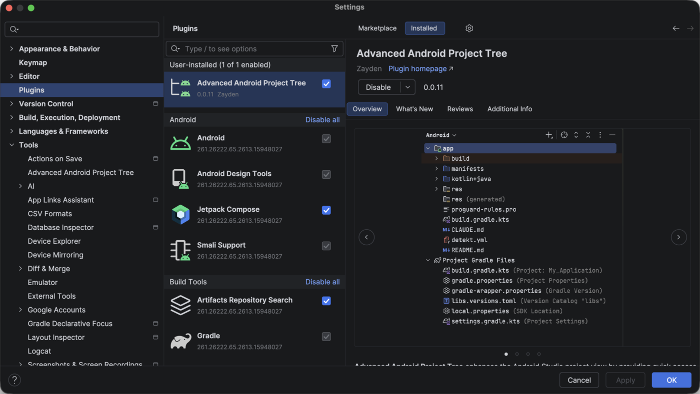
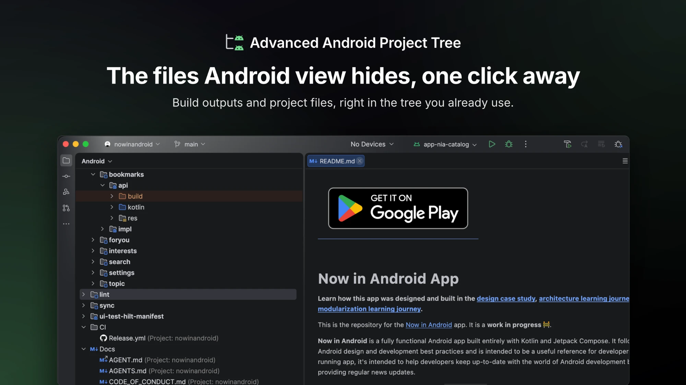
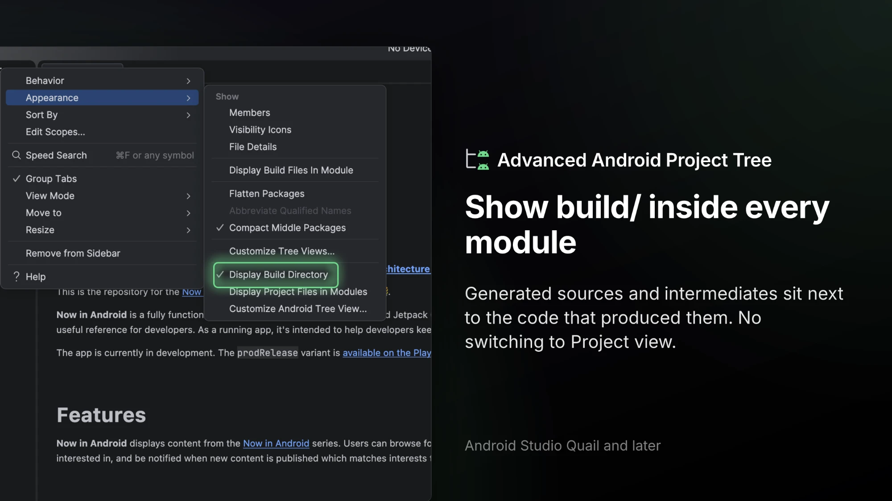
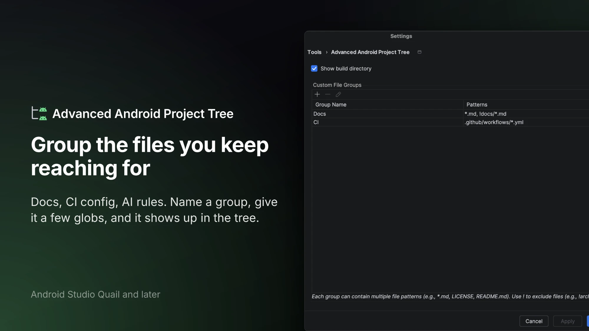
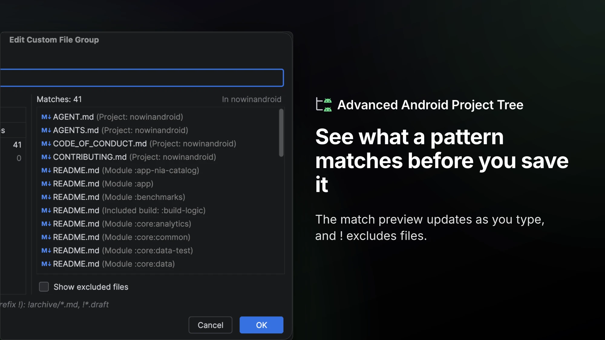
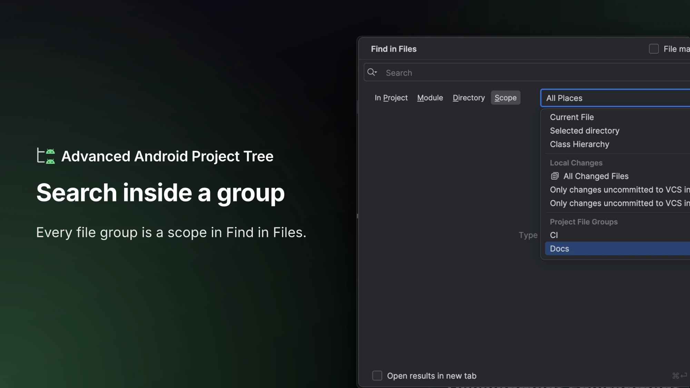

<h1 align="center">Advanced Android Project Tree (A2PT)</h1></br>

<p align="center">
  <a href="https://opensource.org/licenses/Apache-2.0"></a>
  <a href="https://plugins.jetbrains.com/plugin/29829-advanced-android-project-tree"></a>
  <a href="https://github.com/z8dn/advanced-android-project-view/actions"></a>
</p>

<!-- Plugin description -->
<p><strong>Advanced Android Project Tree</strong> enhances the Android Studio project view by providing quick access to commonly used directories and files that are normally hidden or difficult to navigate to.</p>

<h3>Features</h3>
<ul>
  <li><strong>Quick Access to Build Directories:</strong> Navigate directly to build outputs, generated sources, and intermediate files without switching views or using the file system explorer.</li>
  <li><strong>Customizable Project Groups:</strong> Organize project files with configurable groups in the project tree, tailored to your workflow and development needs.</li>
  <li><strong>Hidden Files Visibility:</strong> Easily access configuration files and directories that are typically hidden from the standard Android view, improving discoverability and reducing context switching.</li>
  <li><strong>Search Within a Group:</strong> Every file group is available as a scope in Find in Files, so you can search only your docs, CI config, or AI rules.</li>
</ul>
<!-- Plugin description end -->

## 🗺️ Roadmap

We have exciting plans for future updates! Here are some features currently under consideration or in development:

- [x] **IDE Account Sync**: Sync your custom group configurations across different machines using your IDE account
- [x] **Enhanced Filtering**: Exclusion patterns (`!archive/*.md`) and path-based globs (`docs/**`) for file groups ([#32](https://github.com/z8dn/advanced-android-project-view/issues/32))
- [ ] **Saved Presets**: Pre-defined file groups for common stacks (KMP, Compose Multiplatform, etc.) ([#30](https://github.com/z8dn/advanced-android-project-view/issues/30))
- [ ] **Dynamic Icons**: Customizable icons for specific file patterns ([#31](https://github.com/z8dn/advanced-android-project-view/issues/31))

Have a suggestion? Feel free to open an [issue](https://github.com/z8dn/advanced-android-project-view/issues) or start a [discussion](https://github.com/z8dn/advanced-android-project-view/discussions)!

## Installation

### From JetBrains Marketplace (Recommended)
1. Open Android Studio
2. Go to **Settings/Preferences** (⌘, on Mac or Ctrl+Alt+S on Windows/Linux) → **Plugins** → **Marketplace**
3. Search for "Advanced Android Project Tree"
4. Click **Install** and restart Android Studio


### Manual Installation
1. Download the [latest release](https://github.com/z8dn/advanced-android-project-view/releases/latest)
2. Open Android Studio
3. Go to **Settings/Preferences** (⌘, on Mac or Ctrl+Alt+S on Windows/Linux) → **Plugins** → ⚙️ → **Install Plugin from Disk...**
4. Select the downloaded ZIP file
5. Restart Android Studio

## Usage



### Toggle Build Directory Visibility
1. Open the Android Project View
2. Click the ⋮ (Options) menu in the Project tool window header and open **Appearance**
3. Toggle **Display Build Directory** on or off



The same menu also has:
- **Display Project Files in Modules** — list matched files directly under the module that contains them, instead of in group folders at the project root
- **Customize Android Tree View...** — opens the plugin's settings page

### Configure Project File Groups
1. Go to **Settings/Preferences** → **Tools** → **Advanced Android Project Tree**
2. Click **Add** (+) to create a new file group
3. Enter a group name (e.g., "Docs", "CI", "AI Rules")
4. Add file patterns. The **Matches** preview updates as you type and shows how many files each pattern picks up
5. Click **OK** to apply changes





A group with no matching files does not appear in the tree.

**Pattern Rules:**
- A pattern without `/` matches file names at the top level of the project and of each module, not in subfolders: `*.md`, `CLAUDE.md`
- A pattern with `/` matches the path from the project root and should start with a folder name: `docs/*.md`, `.github/workflows/*.yml`
- `*` stays within one folder, `**` crosses folders: `docs/*.md` matches `docs/guide.md` only, while `docs/**` also matches `docs/api/v1.md`
- A pattern starting with `!` excludes files: `!docs/archive/**`, `!*.draft`
- Matching is case-insensitive
- Each group needs at least one inclusion pattern

**Pattern Examples:**
- `*.md` — Markdown files at the top of the project and each module, like `README.md`
- `CLAUDE.md`, `AGENTS.md` — AI rules files
- `.github/**` — everything under `.github/`
- `docs/**` + `!docs/archive/**` — everything under `docs/` except `docs/archive/`

### Add a Directory from the Project View
Right-click a directory in the Project View and choose **Include Directory in File Group**. Pick an existing group to add `<directory>/**` to it, or **New Group...** to create a group from that directory.

### Search Within a File Group
In **Find in Files** (⇧⌘F on Mac, Ctrl+Shift+F on Windows/Linux), choose **Scope** and pick a group under **Project File Groups**.



Settings are saved automatically, persist across IDE restarts, and sync across machines when Settings Sync is turned on.

## Compatibility

- **Android Studio**: Quail 1 (2026.1.1) and later, per `pluginSinceBuild = 261`
- **IntelliJ IDEA**: not supported — the plugin targets Android Studio explicitly, by depending on
  `com.intellij.modules.androidstudio`
- **Platform**: All (Windows, macOS, Linux)

## Building from Source

### Prerequisites
- JDK 21 or later
- Gradle 9.7.0 (included via wrapper)
- Android Studio Quail 3 or later (for local development)

### Build Steps

```bash
# Clone the repository
git clone https://github.com/z8dn/advanced-android-project-view.git
cd advanced-android-project-view

# Build the plugin
./gradlew buildPlugin

# The plugin ZIP will be created in build/distributions/
```

To try your changes, `./gradlew runIde` starts a sandbox Android Studio with the plugin installed, and `./gradlew test` runs the unit tests. See [CONTRIBUTING.md](CONTRIBUTING.md) for more.

## License

```text
Copyright (c) 2026 z8dn

Licensed under the Apache License, Version 2.0 (the "License");
you may not use this file except in compliance with the License.
You may obtain a copy of the License at

    https://www.apache.org/licenses/LICENSE-2.0

Unless required by applicable law or agreed to in writing, software
distributed under the License is distributed on an "AS IS" BASIS,
WITHOUT WARRANTIES OR CONDITIONS OF ANY KIND, either express or implied.
See the License for the specific language governing permissions and
limitations under the License.
```

## Acknowledgments

- Built with [IntelliJ Platform Plugin Template](https://github.com/JetBrains/intellij-platform-plugin-template)
- Inspired by the need for better Android project navigation
- Thanks to all [contributors](https://github.com/z8dn/advanced-android-project-view/graphs/contributors)

## Support

- 🐛 [Issue Tracker](https://github.com/z8dn/advanced-android-project-view/issues)
- 💬 [Discussions](https://github.com/z8dn/advanced-android-project-view/discussions)

---

**Made with ❤️ for the Android developer community**
